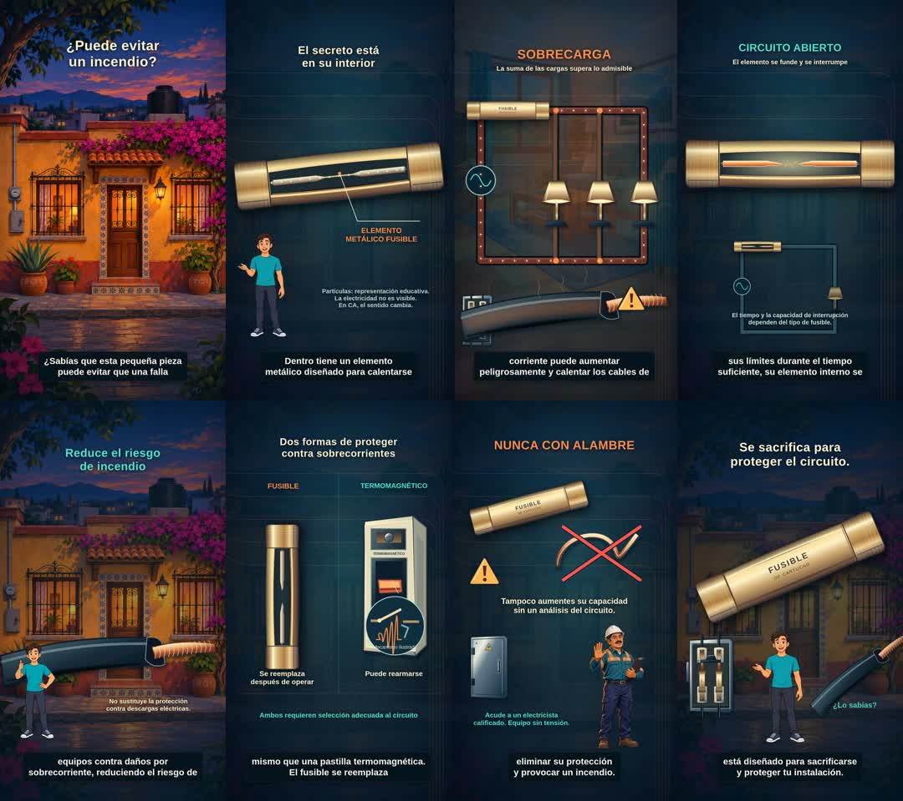

# Entrega del episodio 09

## Resultado

Implementación de ocho escenas animadas en Remotion, 15 ilustraciones nuevas organizadas y un MP4 de revisión. La narración oficial sigue pendiente de autorización de **5.75 créditos**; por ello **no se entrega todavía un máster final narrado ni subtítulos sincronizados a una voz real**.

El borrador está en `out/episodio-09/episodio-09-BORRADOR-sin-voz.mp4`. Su pista AAC contiene silencio. Los subtítulos actuales son una guía temporal con el guion oficial completo, no una transcripción de Grady. No se usó otra voz ni la API directa de ElevenLabs. No se consumieron créditos externos.

Archivo verificado: **70.000000 s** tanto en video como en audio y contenedor, **2100 fotogramas**, **1080 × 1920**, **30 fps**, H.264 y AAC estéreo a 48 kHz. Tamaño: 36,475,206 bytes. Se corrigieron 16 ms de relleno AAC mediante remultiplexado con copia del video, sin volver a renderizar ni recodificar la imagen.

La configuración y el archivo exportado se documentan en `exportacion-verificada.json`; la preservación y el texto de subtítulos, en `validacion.json`. El inventario completo de archivos creados y modificados está en `archivos.json`; los SHA-256 de cada recurso nuevo, en `recursos.json`.

## Validación realizada

- TypeScript sin errores.
- Remotion Studio cargado en Chromium, sin errores de página; vista `http://localhost:3000/Episodio09`.
- Revisión de fotogramas de las ocho escenas y de los momentos de sobrecarga, fusión y circuito abierto. Se corrigieron recortes del cartucho y la representación de las cargas en paralelo, aguas abajo del fusible.
- Guion de 189 palabras preservado en los 25 subtítulos provisionales; máximo dos líneas, sin cortar palabras.
- 97 archivos originales comprobados byte por byte, sin cambios. El registro de la composición anterior también conserva todos sus parámetros.
- Referencias eléctricas y simplificaciones ilustrativas documentadas en `REVISION-TECNICA.md`.
- Un único render completo para el borrador. Las revisiones anteriores se hicieron con fotogramas a media resolución. No se ha exportado un supuesto final sin narración.

## Archivos compartidos modificados

`src/Root.tsx` agrega únicamente el registro del episodio 09. `package.json` agrega los paquetes de audio y subtítulos y comandos específicos del nuevo episodio. Se crean un lockfile y `.gitignore`. Los componentes de los episodios previos, sus imágenes, guías y workflows no se alteraron.

## Guardado

Rama: `codex/episodio-09-fusible`.

[PR de trabajo #13](https://github.com/hermmez/corazon-al-limite./pull/13), mantenido en borrador porque falta aprobar y generar Grady. No se fusionó a `main`.

## Pendiente para terminar el máster

Autorizar los 5.75 créditos cotizados para `elevenlabs_v4`, voz Grady preset `e2a2d2e6-9ed2-59cd-82af-feaa27f8a678`. Después, generar exclusivamente la narración en Higgsfield, escuchar y medir el resultado, alinear los subtítulos y las acciones al audio real, comprobar una dicción natural y exportar el final. La importación local y los controles de exportación están implementados; los pasos se detallan en `README.md`.

No se encontró la composición aprobada del episodio 04 en el checkout disponible. Se consultaron sus referencias del cerebro y se reutilizó la biblioteca aprobada del personaje.
